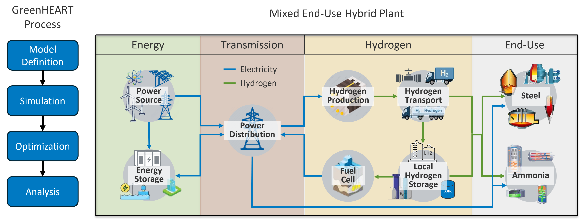

.. _h2i_docs_home:

###########################################################
H2Integrate - Holistic Hybrids Optimization and Design Tool
###########################################################

.. image:: https://badge.fury.io/py/h2integrate.svg
   :alt: PyPI version
   :target: https://badge.fury.io/py/h2integrate

.. image:: https://github.com/NatLabRockies/H2Integrate/actions/workflows/ci.yml/badge.svg
   :alt: CI Tests

.. image:: https://img.shields.io/pypi/pyversions/h2integrate.svg
   :alt: image
   :target: https://pypi.python.org/pypi/h2integrate

.. image:: https://img.shields.io/badge/License-BSD%203--Clause-blue.svg
   :alt: License
   :target: https://opensource.org/licenses/BSD-3-Clause

.. image:: https://zenodo.org/badge/DOI/10.5281/zenodo.17903150.svg
   :alt: DOI 10.5281/zenodo.17903150
   :target: https://zenodo.org/records/17903150

H2Integrate (H2I) is an open-source Python package for hybrid systems engineering design and technoeconomic analysis.
It models and optimizes hybrid energy plants that produce electricity, hydrogen, ammonia, steel, and other products, using high-resolution location-specific resource data to perform optimization and scenario analysis.

.. toctree::
   :maxdepth: 2
   :hidden:

   getting_started/index
   user_guide/index
   user_reference
   developer_guide/index
   api
   ../CHANGELOG
   auto_examples/index

*********
Option 1
*********

.. grid:: 1 1 2 3
    :gutter: 2 3 4 4

    .. grid-item-card::

        Getting started
        ^^^

        New to H2Integrate? Check out the First Time User's Guide. It contains an
        introduction to H2Integrate's main concepts.

        +++

        .. button-ref:: getting_started/index
            :expand:
            :color: secondary
            :click-parent:

            Installation, environment variables, and basic setup.

    .. grid-item-card::

        User guide
        ^^^

        The user guide provides in-depth information about running and connecting models
        in H2Integrate.

        +++

        .. button-ref:: user_guide/index
            :expand:
            :color: secondary
            :click-parent:

            To the user guide

    .. grid-item-card::

        User reference
        ^^^

        Explanations, background, configuration, and usage of the core components of H2Integrate.

        +++

        .. button-ref:: user_reference
            :expand:
            :color: secondary
            :click-parent:

            To the reference guide

    .. grid-item-card::

        API reference
        ^^^

        A full reference to every code object in H2Integrate.

        +++

        .. button-ref:: api
            :expand:
            :color: secondary
            :click-parent:

            To the API reference

    .. grid-item-card::

        Contributor's guide
        ^^^

        Want to add to the codebase? Can help add translation or a flowchart to the
        documentation? The contributing guidelines will guide you through the
        process of improving NumPy.

        +++

        .. button-ref:: developer_guide/index
            :expand:
            :color: secondary
            :click-parent:

            To the contributor's guide

*********
Option 2
*********

.. grid:: 1 1 2 3
    :gutter: 2 3 4 4

    .. grid-item-card::

        Technology Models
        ^^^

        Listing and in-depth descriptions of each of technologies for energy generation
        or conversion.

        +++

        .. button-ref:: technology_models/index
            :expand:
            :color: secondary
            :click-parent:

            To the technology reference.

    .. grid-item-card::

        Storage Models
        ^^^

        Guide to energy storage models.

        +++

        .. button-ref:: storage/storage_models_index
            :expand:
            :color: secondary
            :click-parent:

            To the storage reference

    .. grid-item-card::

        Resource Models
        ^^^

        Explanations, background, configuration, and usage of the resource (tides, solar, wind, etc.).

        +++

        .. button-ref:: resource/index
            :expand:
            :color: secondary
            :click-parent:

            To the resource reference

    .. grid-item-card::

        Control Models
        ^^^

        Guide to controlled energy dispatching and optimization.

        +++

        .. button-ref:: control/index
            :expand:
            :color: secondary
            :click-parent:

            To the controller reference

    .. grid-item-card::

        Demand Models
        ^^^

        Learn more about commodity demand profiling.

        +++

        .. button-ref:: demand/index
            :expand:
            :color: secondary
            :click-parent:

            To the demand reference

    .. grid-item-card::

        Finance Models
        ^^^

        Learn more about financial modeling.

        +++

        .. button-ref:: finance_models/finance_index
            :expand:
            :color: secondary
            :click-parent:

            To the finance reference

    .. grid-item-card::

        Reliability Modeling
        ^^^

        Learn more about modeling system and component availability.

        +++

        .. button-ref:: reliability/reliability_guide
            :expand:
            :color: secondary
            :click-parent:

            To the reliability reference

*****************
About H2Integrate
*****************

H2Integrate grew from projects that needed to model and analyze complex hybrid energy systems. It is now maintained as a reusable framework for composing technology performance, cost, finance, and control models, while still allowing users to add project-specific components.

Browse the example workflows in the GitHub repository: https://github.com/NatLabRockies/H2Integrate/tree/main/examples

What is H2Integrate?
====================

H2Integrate is designed to be flexible and extensible, allowing users to create their own components and models for hybrid systems.
Its registered models cover land-based wind and solar PV; wave, tidal, run-of-river hydro, natural gas, nuclear, and grid electricity; hydrogen production and storage; fuel cells; and industrial processes including ammonia, methanol, iron, and steel.
The `Model Overview <user_guide/model_overview.md>`__ lists the current registered models, and model-specific pages describe their capabilities and configuration.
Some models integrate existing tools, including `PySAM <https://github.com/NatLabRockies/pysam>`__ and `ProFAST <https://github.com/NatLabRockies/ProFAST>`__.
The H2Integrate tool is built on top of `NASA's OpenMDAO framework <https://github.com/OpenMDAO/OpenMDAO/>`__, which provides a powerful and flexible environment for modeling and optimization.

.. note::
   H2Integrate was previously known as GreenHEART. The name was updated to H2Integrate to better reflect its expanded capabilities and focus on integrated energy systems.

**************************
How does H2Integrate work?
**************************

H2Integrate typically models energy systems on a yearly basis using hourly timesteps (i.e., 8760 operational data points across a year).
Results from these simulations are then processed across the project's lifecycle to provide insights into the system's performance, costs, and financial viability.
Depending on the models used and the size of the system, H2Integrate can simulate systems ranging from the kW to GW scale in seconds on a personal computer.
Additionally, H2Integrate tracks the flow of electricity, molecules (e.g., hydrogen, ammonia, methanol), and other products (e.g., steel) between different technologies in the energy system.

.. note::

   Some models are now able to operate with non-hourly time steps.
   Appropriate time step bounds are included as class attributes when non-hourly time steps are permitted.
   Check individual model docs and definitions for time step bounds for individual models. All models in a given simulation must be compatible with the specified time step.

For each technology there are 4 different types of models: control, performance, cost, and finance. These model categories allow for modular pieces to be brought in or re-used throughout H2Integrate, as well as ease of development and organization. Note that the only required models for a technology are performance and cost, while control and finance are optional. The figure below shows these four categories and some of the technologies included in H2Integrate. For a full list of models available, please see `Model Overview <user_guide/model_overview.md>`__.

.. image:: tech-model.png
   :alt: A representation of a single technology model in H2Integrate

The individual technology models are then connected to create the hybrid system model, as shown in the simplistic example below. Here, data from the performance, cost, and finance models of the grid and battery technologies feed into the overall system performance and finance calculations. There is also a physical connection between the grid and battery performance models in the form of an electrical cable. Lastly, within the battery technology, the control model and performance models are connected for dispatching of electricity.

.. image:: system-model.png
   :alt: A representation of a system model in H2Integrate

If technologies require resource or price profiles, they can be provided by the user, or in many cases pulled automatically from existing databases. The costs and performance of the technology models in the system are combined into system-level performance and finance components for techno-economic analysis of the hybrid system. H2Integrate systems may include multiple system-level finance models to assess results with different system boundaries if desired. Besides simulation and analysis, H2Integrate can also perform system and sub-system optimization.

A more complex and generalized example of an H2Integrate model is shown below:

The modular nature of the H2Integrate system makes adding custom models, including proprietary models for local analysis only, very straightforward.

How does H2Integrate differ from other tools?
=============================================

H2Integrate is developed at NLR, which has a long history of developing high-quality tools for renewable energy systems.
Although there are many tools available for modeling hybrid energy systems, H2Integrate is unique in its focus on component-level modeling and design including nonlinear physics models, as well as its modularity and extensibility.
H2Integrate stands out by offering a modular approach that models the entire energy system, from generation to end-use products such as hydrogen, ammonia, methanol, and steel, which is a capability not commonly found in other tools.

`REopt <https://reopt.nlr.gov/tool>`__ is similar to H2Integrate in that it models hybrid energy systems, though it is a higher-level tool that focuses on linear optimization.
One significant difference is that REopt can accommodate various external loads such as steel or ammonia, as long as the user provides the load profiles for those end-uses.
H2Integrate models the processes themselves and does not require the user to provide a load profile, instead modeling what the load profile would be based on physics-based or analytical models.

`SAM <https://sam.nlr.gov/>`__ is another relevant tool (that H2Integrate partially uses), which gives more detailed performance and financial modeling capabilities than REopt.
Like REopt, SAM also does not model loads or end-uses but accepts timeseries data of the loads for design purposes.

H2Integrate goes into more component-level details than those tools, especially in terms of nonlinear physics-based modeling and design.

************
Publications
************

For more context about H2Integrate and analyses performed using the tool, see the publications below.
PDFs are available in the linked titles.

.. note::
   H2Integrate was previously known as GreenHEART, and some publications or references may refer to it by that name.

Techno-economic analysis of low-carbon hydrogen production pathways for decarbonizing steel and ammonia production
==================================================================================================================

Reznicek, E.P., et al. "`Techno-economic analysis of low-carbon hydrogen production pathways for decarbonizing steel and ammonia production. <https://www.cell.com/cell-reports-sustainability/pdfExtended/S2949-7906(25)00034-5>`__" Cell Reports Sustainability. Vol. 2. No. 4. Elsevier, 2025.

Nationwide techno-economic analysis of clean hydrogen production powered by a hybrid renewable energy plant for over 50,000 locations in the United States
==========================================================================================================================================================

Grant, E., et al. "`Hybrid power plant design for low-carbon hydrogen in the United States. <https://iopscience.iop.org/article/10.1088/1742-6596/2767/8/082019/pdf>`__" Journal of Physics: Conference Series. Vol. 2767. No. 8. IOP Publishing, 2024.

Exploring the role of producing low-carbon hydrogen using water electrolysis powered by offshore wind in facilitating the United States' transition to a net-zero emissions economy by 2050
===========================================================================================================================================================================================

Brunik, K., et al. "`Potential for large-scale deployment of offshore wind-to-hydrogen systems in the United States. <https://iopscience.iop.org/article/10.1088/1742-6596/2767/6/062017/pdf>`__" Journal of Physics: Conference Series. Vol. 2767. No. 6. IOP Publishing, 2024.

Examining how tightly-coupled gigawatt-scale wind- and solar-sourced H2 depends on the ability to store and deliver otherwise-curtailed H2 during times of shortages
====================================================================================================================================================================

Breunig, Hanna, et al. "`Hydrogen Storage Materials Could Meet Requirements for GW-Scale Seasonal Storage and Green Steel. <https://assets-eu.researchsquare.com/files/rs-4326648/v1_covered_338a5071-b74b-4ecd-9d2a-859e8d988b5c.pdf?c=1716199726>`__" (2024).

DOE Hydrogen Program review presentation of H2Integrate
=======================================================

King, J. and Hammond, S. "`Integrated Modeling, TEA, and Reference Design for Renewable Hydrogen to Green Steel and Ammonia - GreenHEART <https://www.hydrogen.energy.gov/docs/hydrogenprogramlibraries/pdfs/review24/sdi001_king_2024_o.pdf?sfvrsn=a800ca84_3>`__" (2024).

*****************
Software Citation
*****************

If you use this software in your work, please cite using the following BibTeX:

.. code-block:: bibtex

   @software{brunik_2025_17903150,
     author = {Brunik, Kaitlin and
       Grant, Elenya and
       Thomas, Jared and
       Starke, Genevieve M and
       Martin, Jonathan and
       Ramos, Dakota and
       Koleva, Mariya and
       Reznicek, Evan and
       Hammond, Rob and
       Stanislawski, Brooke and
       Kiefer, Charlie and
       Irmas, Cameron and
       Vijayshankar, Sanjana and
       Riccobono, Nicholas and
       Frontin, Cory and
       Clark, Caitlyn and
       Barker, Aaron and
       Gupta, Abhineet and
       Kee, Benjamin (Jamie) and
       King, Jennifer and
       Jasa, John and
       Bay, Christopher},
     title = {H2Integrate: Holistic Hybrids Optimization and Design Tool},
     month = dec,
     year = 2025,
     publisher = {Zenodo},
     version = {0.4.0},
     doi = {10.5281/zenodo.17903150},
     url = {https://doi.org/10.5281/zenodo.17903150},
   }
